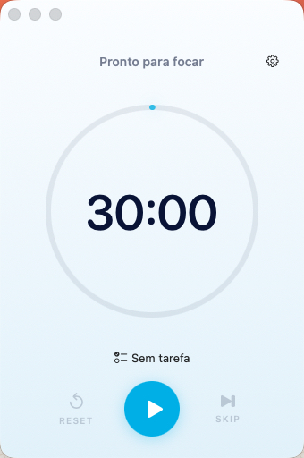

# Tomafoco

Timer Pomodoro para macOS que **bloqueia de verdade** os sites e apps que distraem enquanto você foca.

[](https://github.com/ddstec/tomafoco/actions/workflows/ci.yml)
[](LICENSE)


<p align="center">
  
</p>

**Só quer usar?** Baixe a versão assinada, notarizada e com atualização automática em
**[tomafoco.dds.tec.br](https://tomafoco.dds.tec.br)**.

## Funcionalidades

- **Timer Pomodoro** — foco, intervalo curto e intervalo longo, ciclos configuráveis, avanço manual ou automático das etapas.
- **Bloqueio de sites** por automação do navegador ([ADR-8](docs/arquitetura.md#11-decisões-de-arquitetura-adr-resumido)): redireciona as abas bloqueadas para uma página local — sem root, sem senha, imune a DNS de VPN/DoH. Safari, Chrome, Edge, Brave, Opera e Vivaldi (o Firefox não expõe abas por AppleScript).
- **Bloqueio de apps** — encerra o app bloqueado, observa relançamentos e avisa na tela.
- **Bloqueio contínuo (opcional)** — mantém o bloqueio enquanto o Tomafoco estiver aberto, com senha para liberar um app (guardada no Keychain).
- **Tela cheia de intervalo** — cobre todos os monitores; Esc dispensa.
- **Tarefas, projetos e quadro Kanban** — tags livres, importação do app Lembretes (EventKit) e vínculo tarefa ↔ sessão.
- **Relatórios** — horas por tarefa/dia, intervalos e sequência de dias (Swift Charts), com exportação em PDF.
- **Sobrevive a crash, sleep e reboot** — o estado guarda o término absoluto da etapa e há fluxo de recuperação.
- **Atualização automática** via [Sparkle](https://sparkle-project.org) — checa uma vez por dia e pergunta antes de instalar.

Tudo roda localmente: o app não tem conta, telemetria nem servidor próprio.

## Arquitetura

Clean Architecture com um pacote SPM por camada, dependências apontando sempre para o domínio:

```
Presentation (App/, SwiftUI)  →  TomafocoApplication  →  TomafocoDomain  ←  TomafocoInfrastructure
```

- **TomafocoDomain** — núcleo puro (entidades, value objects, ports). Sem AppKit.
- **TomafocoApplication** — casos de uso, `SessionStateMachine` pura e `SessionCoordinator`. Depende só do Domain.
- **TomafocoInfrastructure** — adapters do macOS (automação de navegador, `NSWorkspace`, EventKit, SwiftData, notificações, Keychain).
- **App/** — Composition Root (`AppContainer`) e a interface SwiftUI.
- **TomafocoTestSupport** — fakes e spies dos ports, compartilhados pelos testes.

Regras de ouro: nada de `Date()`/`Timer` no Domain/Application (tudo via `SessionClock`); efeitos colaterais saem da máquina de estados como `SessionEffect` e quem executa é o `SessionCoordinator`.

Detalhes, ports e decisões (ADRs) em **[docs/arquitetura.md](docs/arquitetura.md)**.

## Compilar a partir do código

Pré-requisitos:

- macOS 14+ e Xcode 15+ (Swift 5.9)
- [XcodeGen](https://github.com/yonaskolb/XcodeGen): `brew install xcodegen`
- (opcional) [SwiftLint](https://github.com/realm/SwiftLint): `brew install swiftlint`

```bash
git clone https://github.com/ddstec/tomafoco.git
cd tomafoco
make open    # gera o Tomafoco.xcodeproj a partir do project.yml e abre no Xcode
make test    # roda os testes de todos os pacotes SPM
```

O `.xcodeproj` **não é versionado** — o `project.yml` é a fonte da verdade. Rode `make project` depois de cada `git pull` que mexer nele.

**Assinatura.** Sem configurar nada, o Xcode assina o app para rodar só na sua máquina. Para assinar com o seu time Apple Developer:

```bash
cp Config/Local.xcconfig.example Config/Local.xcconfig   # e preencha DEVELOPMENT_TEAM
make project
```

Com a assinatura local, o macOS pode voltar a pedir a permissão de Automação depois de recompilar; com um time configurado isso não acontece.

## Permissões (TCC)

- **Automação** (Ajustes do Sistema › Privacidade e Segurança › Automação): autoriza o Tomafoco a pilotar cada navegador — pedida uma vez por navegador. Sem ela, o site não é bloqueado.
- **Lembretes**: só se você importar tarefas do app Lembretes.

Se um site não bloquear, o problema é permissão de Automação, navegador não suportado (Firefox) ou navegador fechado — não há DNS nem rede no caminho.

## Distribuição

A versão oficial é distribuída fora da Mac App Store, assinada com Developer ID e notarizada. `make release` gera o `.dmg` assinado, notarizado e grampeado, e o `appcast.xml` do Sparkle assinado com a chave EdDSA do projeto. Passo a passo em **[docs/release.md](docs/release.md)**.

## Forks e marca

O código é livre; o nome **Tomafoco**, o ícone do tomate e a identidade visual DDS.TEC não. Se você distribuir uma versão modificada, troque o nome, o ícone, o `PRODUCT_BUNDLE_IDENTIFIER` e as chaves `SUFeedURL`/`SUPublicEDKey` do `project.yml` (senão o seu build vai oferecer as atualizações oficiais aos seus usuários). Detalhes em **[TRADEMARKS.md](TRADEMARKS.md)**.

## Contribuir

Issues e pull requests são bem-vindos — leia o **[CONTRIBUTING.md](CONTRIBUTING.md)** antes. Vulnerabilidades: **[SECURITY.md](SECURITY.md)** (não abra issue pública). Este projeto segue o **[Código de Conduta](CODE_OF_CONDUCT.md)**.

## Emergência (versões antigas)

Até o ADR-8 o bloqueio de sites usava o `/etc/hosts`. Se a sua máquina ainda tiver um bloco órfão de uma versão antiga:

```bash
sudo sed -i '' '/# Tomafoco-START/,/# Tomafoco-END/d' /etc/hosts
```

## Licença

Copyright © 2026 Danilo Dumba (DDS.TEC).

Licenciado sob a **GNU Affero General Public License v3.0 ou posterior** — veja [LICENSE](LICENSE). O nome e a identidade visual são regidos à parte pelo [TRADEMARKS.md](TRADEMARKS.md).

Usa o [Sparkle](https://github.com/sparkle-project/Sparkle) (licença MIT).
